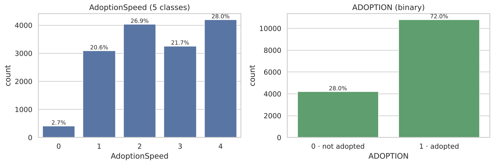
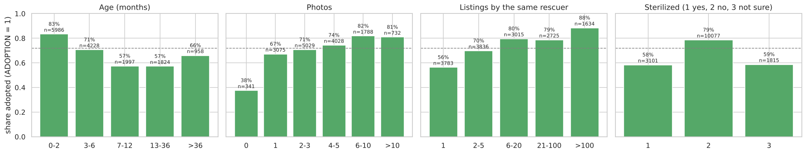
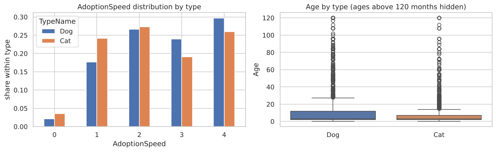

# Initial data diagnostic: PetFinder adoption data

*Task 0 (Know your Data) · AA 2026/27 · 27 Nov 2026*

This is a short summary of the first exploratory data analysis (EDA). Everything below was computed in [`notebooks/01_EDA.ipynb`](../notebooks/01_EDA.ipynb), which also holds the figures, tables and code. No model has been trained yet, and no value in the data has been changed.

## In one paragraph

The dataset has **14,993 pet listings from Malaysia** (8,132 dogs, 6,861 cats) and 24 columns. Once the file is parsed correctly it is **cleaner than we first thought**: only `Name` has missing values, and every coded value is in its documented range. The real issues are **class imbalance** (72% of pets adopted, and only 2.7% adopted on the same day), a few **inconsistencies between columns** (e.g. dog breeds attached to cats), **strongly skewed numbers** (fee, age, quantity), **high-cardinality categories** (176 breeds, 5,595 rescuers) and a **leakage risk** through rescuers with many listings. No single feature predicts adoption well; age, number of photos, rescuer activity and sterilisation status show the clearest patterns.

## 1. Loading: the file needs a custom parser

`pandas.read_csv` misreads the file: records end in a run of `;`, about 60% are wrapped in outer quotes, and descriptions contain unquoted commas and line breaks. We wrote a loader ([`src/preprocessing/loader.py`](../src/preprocessing/loader.py)) that anchors each record on its last three fields and recovers all **14,993 records with no parsing errors**.

> **Correction.** Our first audit (24 Nov, used for `docs/DATA_DICTIONARY.md`) used a simpler parser. The missing values it reported in `Type`, `Age`, `Breed1` and `AdoptionSpeed`, and codes such as `Gender = 265` or `VideoAmt = 41401`, were **parsing artefacts** caused by shifted columns, not errors in the data. The data dictionary has been updated.

## 2. Targets and class balance

| Target | Classes | Distribution | Majority baseline |
|---|---|---|---|
| `ADOPTION` (new, binary) | 1 = adopted (`AdoptionSpeed` 0–3), 0 = not adopted (4) | **72.0% / 28.0%** | 72.0% accuracy |
| `AdoptionSpeed` (5 classes) | 0 same day · 1 week 1 · 2 month 1 · 3 months 2–3 · 4 not adopted after 100 days | 2.7% · 20.6% · 26.9% · 21.7% · 28.0% | 28.0% accuracy |
| `AdoptionSpeed` grouped {0–1, 2–3, 4} | as suggested in the template | 23.3% · 48.7% · 28.0% | 48.7% accuracy |

**Implications.** Accuracy alone is misleading for `ADOPTION` (a model that always says "adopted" scores 72%). We will use **stratified cross-validation** and report **macro-F1, balanced accuracy, per-class recall, confusion matrices** and **ROC-AUC**. In the 5-class problem, class 0 is so rare that most classifiers will ignore it; the 3-class grouping is a reasonable alternative to study. `AdoptionSpeed` is ordinal, so some mistakes are worse than others.

## 3. Missing values and duplicates

- **`Name` is the only empty column: 1,257 listings (8.4%).** Another 129 names are placeholders ("No Name Yet"), and about 840 describe a group ("2 Kittens"). We suggest a `HasName` feature rather than imputation.
- **Hidden "unknowns":** `Vaccinated`, `Dewormed` and `Sterilized` use code 3 = "Not sure" for **12–13%** of listings. Keep it as its own category.
- **8 pairs of duplicate listings** (identical except for `PetID`). Drop one copy of each, or the same pet could appear in both training and test folds.

## 4. Errors, typos and inconsistencies

No value is outside its documented domain. The problems are inconsistencies and implausible values:

| Issue | Rows | Proposed handling |
|---|---|---|
| Breed of the wrong species (e.g. a cat labelled "Shih Tzu" or dog "Mixed Breed") | 12 (`Breed1`) + 3 (`Breed2`) | Set to unknown, or to the species' mixed/domestic code |
| `Breed1 = 0` (no primary breed) | 5 | Treat as unknown |
| `Breed2` identical to `Breed1` | 1,510 (10%) | Set `Breed2 = 0` before building a "mixed breed" feature |
| Age above 15 years (up to 21) | 6 | Keep but clip or bin |
| Age heaping: 75% of adult ages are whole years | — | Bin `Age` instead of using it raw |
| Sterilised at 3 months or younger | 279 | Flag; plausible for some shelters |
| Fee outliers (up to RM 3,000; median 0) | — | Log-transform or bin |
| Mis-encoded characters in names | 147 | Only matters if text is used |

## 5. High-cardinality features

| Feature | Distinct values | Observation | Suggestion |
|---|---|---|---|
| `Breed1` | 176 | 3 codes cover 72% (Mixed Breed 40%, Domestic Short Hair 24%, Domestic Medium Hair 8%); 38 cover 95% | Top-k breeds + "Other", or a binary `IsMixedOrDomestic` |
| `State` | 14 | Selangor (58%) and Kuala Lumpur (26%) dominate | {Selangor, Kuala Lumpur, Other} |
| `RescuerID` | 5,595 | Identifier; 3,783 rescuers list one pet, the largest lists 459 | Never a direct feature; use `RescuerCount` with care (§8) |
| `Name`, `Description`, `PetID` | thousands | Text / IDs | Derive simple features only (has name, description length) |

## 6. What relates to adoption?

All associations are **weak to moderate** (strongest Cramér's V ≈ 0.21), so we should expect modest model performance. These are correlations, not causes.

- **Age:** 83% of pets aged 0–2 months are adopted vs. 57% at 7–36 months.
- **Photos:** 38% adopted with no photo vs. 82% with 6–10 photos.
- **Rescuer activity:** 56% adopted for one-off rescuers vs. 88% for rescuers with more than 100 listings.
- **Sterilisation:** non-sterilised pets are adopted *more* often (79% vs. 58%), and the gap persists within every age group. We have no tested explanation yet; it is a good topic for the critical discussion.
- `Fee`, `VideoAmt` (96% zeros), `Quantity` and description length show almost no relation to adoption speed.

## 7. Cats vs. dogs

| | Dogs | Cats |
|---|---|---|
| Listings | 8,132 (54%) | 6,861 (46%) |
| Adopted (`ADOPTION = 1`) | 70.3% | 74.0% |
| Adopted within the first week (classes 0–1) | 19.7% | 27.6% |
| Median age | 3 months | 3 months |
| Vaccinated | 48% | 29% |
| Distinct primary breeds | 116 | 68 |

Cats are adopted somewhat more often and faster. Breed codes are disjoint between species, and some features relate to adoption differently (vaccination matters more for cats; breed, state and fur length more for dogs). This supports trying specialised models in Task 1.3, but only cross-validation can tell whether they actually perform better.

## 8. Leakage risks to handle before modelling

1. **Rescuers in both train and test.** Large rescuers post many similar listings with similar outcomes. We should compare stratified k-fold with **`GroupKFold` by `RescuerID`** to measure how optimistic random splits are.
2. **`RescuerCount` computed on the full data** uses test rows. Compute it within training folds, or justify it as information available at listing time.
3. **Duplicates** (see §3).
4. **Preprocessing fitted on all data.** Scalers, encoders and category groupings must be fitted inside a scikit-learn `Pipeline` within cross-validation.

## 9. Proposed preprocessing (for team discussion)

1. Load with the custom loader; create `ADOPTION`.
2. Drop the 8 duplicate copies.
3. Fix breed/species inconsistencies; `Breed2 = Breed1` → 0.
4. Keep "Not sure" as a category.
5. Group rare categories (`Breed1`, `State`).
6. Log-transform or bin skewed numbers (`Age`, `Fee`, `Quantity`, `PhotoAmt`); consider dropping `VideoAmt`.
7. Build simple features: `HasName`, `DescLength`, `IsMixedBreed`, `NumColors`, `RescuerCount`.
8. Drop identifiers and raw text from the feature matrix.
9. One-hot encode nominal features, keep ordinal ones ordered, scale numeric features, all inside a `Pipeline`.
10. Imbalance: start with `class_weight="balanced"`; resampling only if the team approves it, since it is outside the core syllabus.
11. Task 2: cluster **adopted pets only**, without `AdoptionSpeed` as an input; use it afterwards as the external label.

## Open questions for the team

- Do we evaluate with stratified k-fold, grouped k-fold by rescuer, or both?
- Which 3-class grouping of `AdoptionSpeed` do we adopt (the template's {0–1, 2–3, 4} or another)?
- Do we use any text features (description length, name present), or leave text out?
